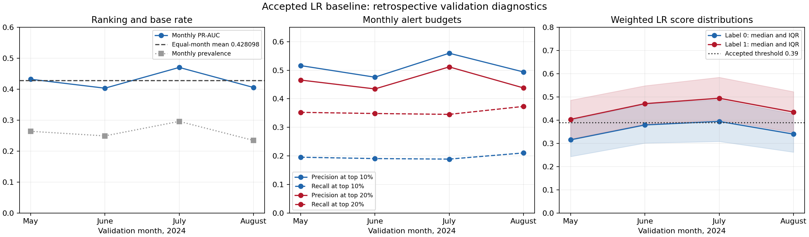

# Accepted LR diagnostics and proposed controlled experiments

This is the historical pre-candidate report. See [completed candidate results](CANDIDATE_RESULTS.md) for the final decision.

Diagnostics are complete. No candidate has been fitted or promoted. The accepted LR bundle and threshold **0.39** remain the baseline. Candidate fitting requires approval of [this exact shortlist](proposed-candidates.json).

## Baseline measured on the agreed objective

The equal-month mean validation PR-AUC is **0.428098323**. The previously recorded pooled value, approximately **0.427191548**, is a different aggregation and is not the comparison baseline. Compute each candidate gain as the mean of the four paired monthly PR-AUC differences. The agreed +0.005 gate is equivalent here to a monthly mean of at least **0.433098323**, using unrounded values in comparisons.

| Validation month | Rows | Prevalence | PR-AUC | Precision at 0.39 | Recall at 0.39 | Alert rate at 0.39 |
|---|---:|---:|---:|---:|---:|---:|
| 2024-05 | 599,226 | 26.41% | 0.432455 | 41.49% | 54.36% | 34.61% |
| 2024-06 | 601,272 | 24.94% | 0.403537 | 34.27% | 73.44% | 53.44% |
| 2024-07 | 613,938 | 29.62% | 0.470587 | 38.79% | 77.50% | 59.19% |
| 2024-08 | 604,303 | 23.47% | 0.405815 | 35.96% | 63.48% | 41.42% |

## Fixed monthly alert budgets

Each month selects exactly floor(10% or 20% of its rows), ordered by descending score then ascending flight ID. No identical `(score, flight_id)` groups occurred in any validation month. A synthetic distributed check passed for equal fractional selection weights when an indistinguishable group crosses the boundary; multiplicity is preserved. These are retrospective monthly batch budgets, not online threshold recommendations.

| Month | Precision at 10% | Recall at 10% | Precision at 20% | Recall at 20% |
|---|---:|---:|---:|---:|
| 2024-05 | 51.63% | 19.54% | 46.56% | 35.26% |
| 2024-06 | 47.57% | 19.07% | 43.46% | 34.85% |
| 2024-07 | 55.95% | 18.89% | 51.17% | 34.55% |
| 2024-08 | 49.39% | 21.05% | 43.81% | 37.33% |
| Equal-month mean | 51.13% | 19.64% | 46.25% | 35.50% |

The mean-recall guardrail floors are **0.186384632** at 10% and **0.344977428** at 20%. They do not prevent individual monthly regressions. Report every monthly change and the worst month, without adding a new elimination rule.

## Diagnosis and limitations

- At threshold 0.39, alert rates range from 34.6% to 59.2%. Top-10% score cutoffs range from 0.509 to 0.611; top-20% cutoffs range from 0.451 to 0.549. Monthly descriptive best-F1 thresholds are 0.34, 0.41, 0.41, and 0.39. These observations do not change the accepted operating threshold. Threshold changes or monotone score remapping alone cannot improve PR-AUC or fixed-budget rankings.
- Score distributions overlap substantially and shift for both labels. The model was fitted with positive-class weight 2.0; its raw scores should not be treated as a guarantee of calibrated natural-prevalence probabilities.
- Full training prevalence is 20.4231%, versus 26.1251% in validation. The largest numeric mean shifts are causal rolling delay rates: destination 30-day rate rises from 0.2064 to 0.2578 (about 0.83 training standard deviations), with similar carrier/origin changes. These are observed cohort/seasonal shifts, not proof that discarding older rows helps.
- Validation contains 194 origin-category rows and 195 destination-category rows unseen by the accepted training indexers. These counts are separate and may overlap. No unseen carrier/month/weekday rows were found.
- Training score diagnostics used 88,978 deterministic approximately 1% sampled training rows. Pooled in-sample PR-AUC is 0.359841, ROC-AUC 0.683724, and prevalence 20.56%. These sampled in-sample results are not validation performance and are not directly comparable to validation PR-AUC at a different prevalence.
- Season-matched 2023 training-sample ROC-AUC is 0.7099/0.7192/0.7189/0.6978 in May-August, versus 0.6864/0.6831/0.6904/0.6966 in 2024 validation. The May-July gap motivates a controlled stronger-regularization test, but in-sample evaluation, sampling, and cohort differences prevent an overfitting conclusion.
- January-April full-population prevalence is 22.02% in 2023 versus 19.99% in 2024. Together with summer changes, this does not isolate a useful classifier fitting window. The third candidate is deliberately withheld.

## Candidates awaiting approval

1. **Positive-class weight 1.0**, with regularization 0.1 and every other accepted setting unchanged. Test whether refitting the weighted objective changes useful rankings; merely lowering scores would not meet the primary criterion.
2. **Regularization 0.3**, with positive-class weight 2.0 and every other accepted setting unchanged. Test stronger shrinkage as a variance-control hypothesis. Do not also try 0.03 without new approval.

Both use all original training rows, the same accepted preprocessing/features, the same four validation months, and unweighted evaluation. Neither is a combined change or an official production bundle. A future classifier fitting window experiment would retain preprocessing fitted on the full original training period and must not be described as an entirely recent-year model.

First filter complete candidates by paired mean PR-AUC gain >=0.005 and mean recall loss <=0.01 at both budgets. Rank qualifying candidates by mean PR-AUC, then mean recall at 10%, mean recall at 20%, and preregistered order. If none qualifies, retain the baseline. The gain gate is a practical study threshold, not statistical significance.

## Execution, budget, and verification

- Cleanup commit: `1005207b1fb868b5ece29b23c426f247a1002a35`. Diagnostics protocol/code was committed before analysis as `e8a47de` on `study/lr-improvement-v1`. Production source, tests, packaging, dependencies, and runtime settings remain unchanged.
- Docker access succeeded through the supported approved execution path outside the sandbox; no group or socket permission changes, dependency installation, rebuild, or image pull was used. The exact accepted image was reused. Thirteen existing packaging tests and an independently inspected 630-file temporary package passed before the cleanup commit.
- Seven synthetic study tests passed. Actual diagnostics verified the existing validation prediction population/threshold, the distributed duplicate-boundary calculation, all four monthly metrics, and frozen-model serialization/reload score equality. Candidate-specific checks are pending fitting approval.
- Active Spark study time: **493.194 seconds** (8 minutes 13 seconds); remaining: **13906.806 seconds** (about 3 hours 52 minutes). Started classifier fits: **0**. The timeout was enforced inside the pinned container. Plotting and host identity checks are not Spark compute.
- At most the two proposed fits may start after approval, sequentially, each capped at 60 minutes including complete evaluation and subject to the remaining total budget. The overall study ceiling remains three started fits; the unused slot is not permission to add another candidate. Interrupted/incomplete candidates consume their spent time and started-fit allowance, are recorded, and are excluded from ranking. No automatic retry, time-limit expansion, or reduced evaluation is allowed.
- [Before/after preservation verification](evidence/baseline-preservation.json) covers 700 protected files: raw data, current artifacts and selection/test feature directories, and B1. Only their identities were inspected for protection; September-December 2024 scores, labels, and metrics were not used for analysis or selection.
- [Budget and command ledger](evidence/budget.json), [complete diagnostic results](evidence/diagnostics/results.json), [full feature profiles](evidence/diagnostics/feature-profiles.json), [training sample report](evidence/diagnostics/training-in-sample.json), and [compact results](results-summary.json) are retained. Compact diagnostic evidence is included here; generated binary artifacts remain local.

No later untouched evaluation period is present. May-August validation already supported original model selection and remains development data. These findings and any approved candidate results are retrospective; no claim of future improvement, model promotion, retraining pipeline run, or remote push is made.
